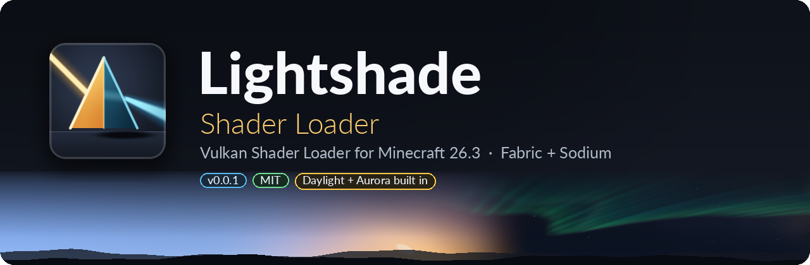
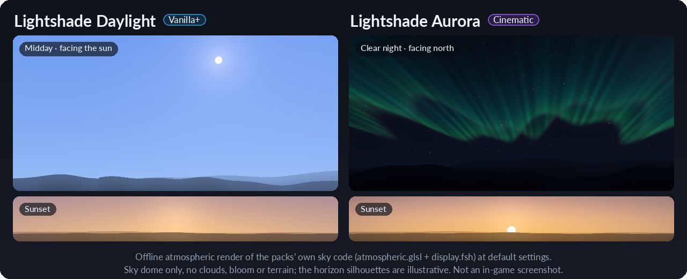
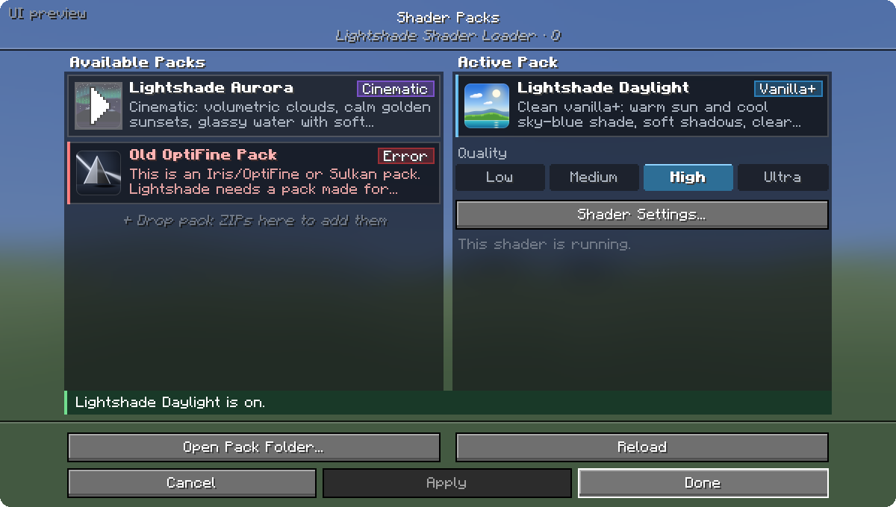
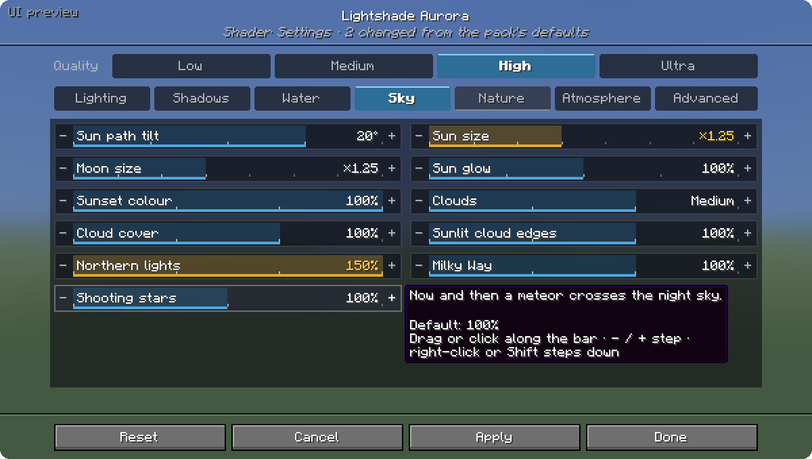

<p align="center">
  
</p>

<p align="center">
  
  
  
  
  
  
</p>

**Lightshade Shader Loader** loads shader packs into Minecraft 26.3's **Vulkan** renderer. It runs on
Fabric next to Sodium, replaces Sodium's terrain programs with the pack's own, and runs a post-processing
graph of up to 32 passes, with real sun shadows from up to three cascaded shadow maps. Two packs come
inside the JAR, so you can start without downloading anything else.

- **Pick packs the way you pick resource packs.** Available packs are on the left, the active pack on the right, with Low / Medium / High / Ultra presets under it.
- **Change settings without restarting.** There are seven tabs of options with fill bars. Apply compiles the change first and saves it only if the compile succeeds; if it fails, the previous pack keeps running.
- **Works alongside the rest of your mods.** Lightshade isn't tied to any modpack. It reads packs from `shaderpacks/`, keeps its settings in `config/lightshade.json` and doesn't touch other mods' files.

## Built-in packs

<p align="center">
  
  <br><sub><i>Offline atmospheric render of the packs' own sky code at default settings: sky dome only, no clouds, bloom or terrain. Not an in-game screenshot.</i></sub>
</p>

| | **Lightshade Daylight** · `Vanilla+` | **Lightshade Aurora** · `Cinematic` |
| --- | --- | --- |
| Look | Clean vanilla+: warm sun, cool sky-blue shade, keeps each biome's own sky colour | Cinematic: deep Rayleigh sky, calm gold-to-indigo sunsets, darker nights |
| Sun shadows | One shadow map, 12-tap Poisson-disk soft edges | Up to three cascades: sharp near you, soft farther out, plus cloud shadows |
| Water | Clear turquoise, two-layer waves, Fresnel reflections of sky, hills and buildings, shoreline foam | Glassier: a fourth reflection-quality level, soft caustics and denser foam |
| Sky & night | Refined clouds at vanilla height, simple stars, optional northern lights | Volumetric clouds, Milky Way, shooting stars, emerald-teal northern lights |
| Weather & dimensions | Vanilla rain | Wet, glossy ground and puddles in rain; ember-red Nether haze; violet End nebula |
| Post-processing | 6 passes: bloom, light shafts, haze, grade | 9 passes: adds a three-level wide bloom and a vignette |
| Options · memory budget | 38 options in 7 tabs · 384 MiB | 50 options in 7 tabs · 640 MiB |

Both packs also come as standalone ZIPs (`Lightshade-Daylight-0.0.1.zip`, `Lightshade-Aurora-0.0.1.zip`).
You only need these as a starting point for your own pack.

## Requirements

| | Version |
| --- | --- |
| Minecraft | **26.3** (Vulkan renderer) |
| Fabric Loader | **0.19.5** or newer |
| Fabric API | **0.164.0+26.3** |
| Sodium | **0.9.3-beta.1+mc26.3** |
| Java | **25** |

**Incompatible:** **Sulkan** and **Iris** (Fabric refuses to start and says why). Other shader loaders,
such as Oculus or OptiFabric, are detected at startup; Lightshade then switches itself off and explains
why in its menu.

## Installation

1. Put `lightshade-shader-loader-0.0.1.jar` in your `mods/` folder together with Fabric API and Sodium.
2. Remove any other shader loader.
3. Start the game. **Lightshade Daylight** is on from the first launch.

Your own packs go in `.minecraft/shaderpacks/`. You can also drag pack ZIPs onto the menu.

## Controls

Open the shader menu with any of these:

- the **`O`** key (rebindable under *Controls → Key Binds → Lightshade Shader Loader*),
- **Options → Shader Packs...**,
- **Video Settings → Lightshade Shaders** (in Sodium's sidebar).

<p align="center">
  
  
  <br><sub><i>UI previews drawn offline from the screens' layout code (LightshadePackScreen, LightshadeSettingsScreen) with a stand-in pixel font, not screenshots.</i></sub>
</p>

- To activate a pack, hover its icon and click **▶** (or double-click the card). Click **◀** on the active pack to turn shaders off.
- **Shader Settings...** opens seven tabs: Lighting, Shadows, Water, Sky, Nature, Atmosphere, Advanced.
  - To change an amount, drag or click along its bar. **−** and **+** step one choice; right-click or Shift steps down.
  - On/off options are switches.
  - Values you have changed are shown in gold. Hover an option to see what it does.
- **Apply** compiles your changes and saves them; **Done** does the same and closes the menu; **Cancel** (or Esc) discards them.

## Making your own pack

A pack is a folder or ZIP with a `lightshade.json` manifest at its root and GLSL 450 sources. The easiest
way to start is to unzip one of the built-in packs and edit it. Then check that it compiles, offline:

```bash
python3 tools/check_shaders.py path/to/MyPack.zip
```

The complete format is in **[docs/PACK_FORMAT.md](docs/PACK_FORMAT.md)**: options and presets, the
pass graph, the uniforms and samplers you can read, `#include` rules and the limits. For how the loader
works inside, see [docs/ARCHITECTURE.md](docs/ARCHITECTURE.md).

## Building and testing from source

The build runs offline with plain `javac`, without Gradle. It reads Minecraft and its libraries from a
Prism Launcher cache, and the exact Fabric API and Sodium JARs from a local folder.

```bash
python3 tools/build.py     # build/lightshade-shader-loader-0.0.1.jar + both pack ZIPs (javac -Xlint -Werror)
python3 tools/test.py      # SPIR-V for every pass × preset × extreme, Java unit tests, translations, JAR contract, naming
python3 tools/deliver.py   # copies the release files and SHA-256 sums to dist/ (only after test.py passes)
```

Setup (`JAVA_HOME`, `LIGHTSHADE_PRISM_CACHE`, `LIGHTSHADE_MODS`) is described in
[CONTRIBUTING.md](CONTRIBUTING.md). The images in this README are generated by
`python3 tools/render_docs_images.py`, and the icons by `python3 tools/icons.py`.

## Status and roadmap

**0.0.1 is the first public release.** Every check that can run offline passes:

- 2,614 SPIR-V compilations covering both packs, every preset and extreme option set, and all of Sodium's terrain variants,
- 301 Java unit-test checks,
- translation and JAR/ZIP contract checks.

**Live GPU verification of 0.0.1 is still underway.** The underlying Vulkan pipeline was developed on a
Linux desktop with an NVIDIA RTX 2080, while the 0.0.1 refactor itself has so far been verified offline.
AMD, Intel and Apple Silicon GPUs haven't been tested yet. Please report what you see.

Planned next:

- [ ] In-game screenshots once live verification is done
- [ ] More hardware coverage (AMD, Intel, Apple Silicon)
- [ ] A per-pass GPU timing overlay in the menu
- [ ] More translations

## Contributing

Bug reports, pack authors' feedback, translations and pull requests are welcome. Read
[CONTRIBUTING.md](CONTRIBUTING.md) and the [Code of Conduct](CODE_OF_CONDUCT.md) first. For security
issues, see [SECURITY.md](SECURITY.md).

## License

[MIT](LICENSE) © 2026 Julian. Minecraft, Fabric, Sodium and LWJGL are separate works by their own
authors; none of them is bundled in or relicensed by this project.
